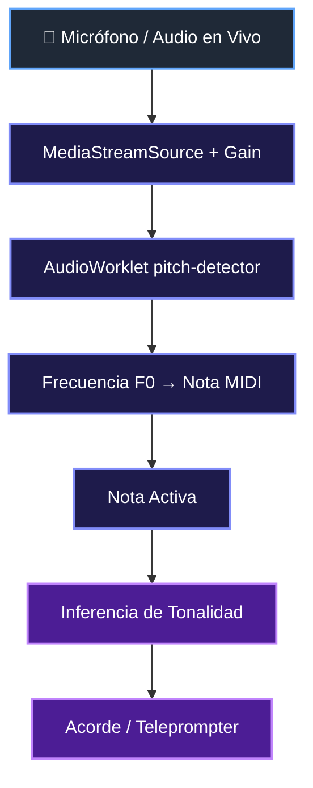
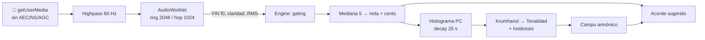
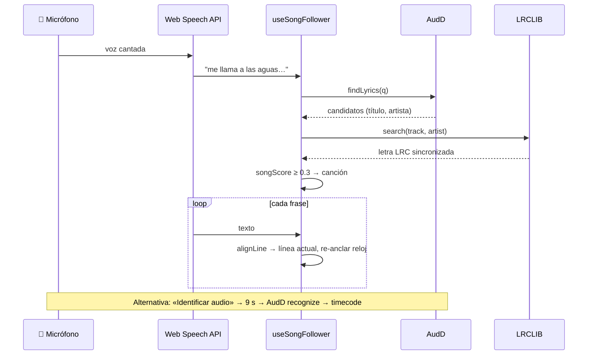
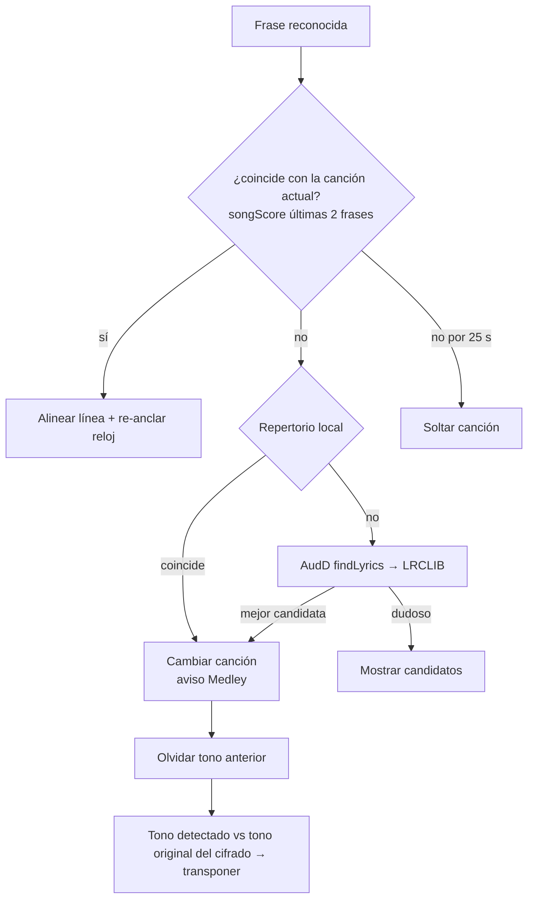
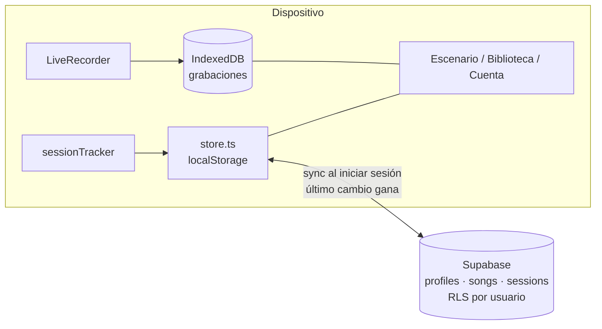

# Documentación de cambios — Live Stage Assistant

> Regla aplicada desde el 2026-10-27: cada cambio del proyecto debe documentarse aquí y guardarse en la subcarpeta `/docs`.

## 2026-10-27 — Inicio del MVP

### Cambio
- Se creó la base del MVP: React 18 + TypeScript + Vite con soporte PWA (`vite-plugin-pwa`).

### Archivos afectados
- Raíz: `package.json`, `vite.config.ts`, `tsconfig.json`, `tsconfig.app.json`, `tsconfig.node.json`, `index.html`, `public/manifest.webmanifest`, `public/icon.svg`, `README.md`, `.gitignore`.
- `src/`: `main.tsx`, `App.tsx`, `index.css`, `vite-env.d.ts`.
- `src/audio/`: `yin.ts`, `pitchWorklet.ts`, `engine.ts`, `music.ts`.

### Decisiones técnicas
- AudioWorklet (blob module) en lugar de ScriptProcessor: requiere menos latencia y está más alineado al futuro.
- Algoritmo YIN con frame de 1024 muestras y umbral de confianza de aceptación de 0.5.
- Cadena de audio: `MediaStreamSource → Gain → AudioWorkletNode → Gain(0) → Destination`.
- Inferencia de tonalidad v1: mejor ajuste de escala (mayor/menor) sobre las últimas notas detectadas.
- Sin high-pass / compresor dinámico todavía (pendiente de integrar).

### Diagrama Mermaid — Flujo del MVP

---

## [DOCS & WORKFLOW REQUIREMENT] — prompt master

- Todo cambio realizado en el proyecto debe ser documentado.
- La documentación se guarda en la subcarpeta `/docs` del proyecto.
- Cada cambio debe incluir, cuando corresponda:
  - Descripción del cambio.
  - Archivos afectados.
  - Decisiones técnicas tomadas.
  - Diagramas Mermaid (flujo / arquitectura / secuencia) cuando aplique.

---

## 2026-10-27 — Debug micrófono + logs en vivo

### Cambio
- Logs en vivo en `App.tsx` y `engine.ts`.
- Error de `getUserMedia` ahora incluye `name` y `message`.
- Estado de permiso consultado antes de solicitar (`[LSA] mic permission state`).
- Frame recibido loguea `[LSA] frame received`.
- Botón "Reintentar micrófono" agregado (`retryCount`).

### Diagnóstico
- Estado de permiso del micrófono: `denied`.
- Error capturado: `NotAllowedError: Permission denied`.

### Archivos afectados
- `src/App.tsx`, `src/index.css`, `docs/CHANGELOG.md`.

---

## 2026-11-06 — Fix del detector de pitch + vista de escenario

### Diagnóstico
El micrófono sí se abría (`MIC ACTIVO`), pero nunca llegaban notas a la UI:
1. **`buildFrame()` del worklet roto**: usaba el mismo `offset` para el frame y para el bloque de 128 muestras; tras el primer bloque leía `buffer[0] === undefined` y el procesador lanzaba una excepción.
2. **`sampleRate` fijo en 44100**: se sobreescribía el global del AudioWorklet; en equipos a 48 kHz todas las notas salían ~1.5 semitonos desplazadas.
3. **YIN mal implementado y O(n³)**: ~10⁸ operaciones por frame (imposible en tiempo real) y sin umbral absoluto.
4. `echoCancellation`/`noiseSuppression` activados: deforman la voz cantada.

### Cambio
- `yin.ts`: YIN correcto (diferencia → CMNDF → umbral 0.15 → interpolación parabólica). ~1 ms por análisis. Una sola implementación: su código se inyecta en el worklet con `toString()`.
- `pitchWorklet.ts`: ring buffer de 2048 muestras, salto de 1024 (~47 análisis/s a 48 kHz), usa el `sampleRate` real, `process()` devuelve `true`.
- `engine.ts`: abre el micrófono él mismo (selector de dispositivo), procesado del navegador desactivado, pasa-altos 60 Hz, nivel de entrada, gating por claridad ≥ 0.8 y RMS.
- `music.ts`: tonalidad por Krumhansl-Schmuckler sobre histograma ponderado por duración con olvido exponencial (vida media 25 s); campo armónico diatónico (V mayor en menor); sugerencia de acorde por nota; notación Do-Re-Mi / C-D-E con bemoles según tonalidad.
- `App.tsx` + `index.css`: vista de escenario — nota gigante con octava, afinador en cents, medidor LED, tarjeta de tonalidad (con bloqueo), acorde sugerido, campo armónico I–vii°, histograma y rastro de notas, pantalla completa, Wake Lock, overlay de errores con mensajes claros, responsive tablet/móvil.
- `main.tsx`: eliminado import de `React` sin usar (rompía `tsc -b`).

### Decisiones técnicas
- Histéresis de tonalidad: un nuevo tono debe ganar ~1.5 s seguidos para reemplazar al actual.
- Mediana de 5 lecturas para eliminar saltos de octava espurios; la nota se mantiene 450 ms tras el silencio.

---

## 2026-11-06 — Reconocimiento de canción + letra que sigue al cantante

### Cambio
La app ahora intenta saber **qué canción se está cantando**, encuentra **en qué parte va** y muestra la letra (pequeña) debajo de la nota (grande).

Tres formas de reconocer:
1. **Por la letra (en vivo)** — Web Speech API transcribe lo que se canta; el fragmento se busca en **AudD `findLyrics`** (búsqueda por texto de letra). Los candidatos se verifican descargando su letra de **LRCLIB** y comparando con lo escuchado (`songScore` ≥ 0.3); si ninguno pasa, se muestran como "¿Es alguna de estas?".
2. **Huella de audio (tipo Shazam)** — botón «Identificar audio»: graba 9 s del micrófono (MediaRecorder) y los envía a **AudD recognize**. Devuelve canción + `timecode`, con lo que la letra sincronizada arranca en el punto exacto. Solo funciona con **grabaciones** (pista, radio, YouTube); una interpretación en vivo no tiene huella.
3. **Búsqueda manual** por título/artista (LRCLIB).

Seguimiento de la posición:
- Con letra sincronizada (LRC) hay un **reloj de canción** que avanza solo.
- Cada frase reconocida por voz se **alinea** con la letra (`alignLine`: bigramas + sesgo hacia la línea actual/siguientes para no saltar al primer coro) y **re-ancla** el reloj, corrigiendo diferencias de tempo en vivo.
- Si 3 frases seguidas no coinciden con la canción, se asume cambio de canción y se vuelve a buscar.
- Flechas ↑/↓ o PageUp/PageDown (pedal Bluetooth) mueven la letra manualmente; clic en la línea anterior/siguiente también.

### Archivos afectados
- Nuevos: `src/song/text.ts`, `lyrics.ts`, `matcher.ts`, `api.ts`, `speech.ts`, `useSongFollower.ts`, `SongBar.tsx`.
- `src/App.tsx` (barra de canción, letra bajo la nota, atajos de teclado, ajustes persistidos), `src/audio/engine.ts` (`mediaStream` getter), `src/index.css`.

### Decisiones técnicas
- Sin backend: AudD y LRCLIB aceptan CORS. AudD funciona **sin token con un límite diario**; el token opcional se guarda en `localStorage` (⚙ Ajustes).
- El reconocimiento de voz depende del navegador: **Chrome y Edge sí; Brave no** (bloquea el servicio de Google → error `network`). En Brave quedan la huella y la búsqueda manual. Nota: en Chrome el audio de voz se procesa en servidores de Google.
- La huella usa el mismo `MediaStream` del afinador (sin abrir otro micrófono). El reconocimiento de voz usa el micrófono predeterminado del sistema (la API no permite elegir dispositivo).
- LRCLIB no busca por texto de letra, solo por título/artista: por eso AudD hace el "texto → canción" y LRCLIB el "canción → letra con tiempos".
- Pendiente: acordes por línea (LRCLIB solo trae letra) y transposición automática del cifrado.

---

## 2026-11-06 — Medleys (cambio automático de canción) + acordes transportados

### Problema
1. Una vez reconocida una canción, la app se quedaba en ella aunque empezaran otra (medleys en iglesias). El cambio solo se detectaba tras 3 frases largas seguidas sin coincidir, y el reloj seguía avanzando la letra vieja.
2. No había acordes: LRCLIB solo trae letra.

### Cambio
**Medleys**
- Tras cada frase reconocida se compara lo último cantado (2 frases) con la canción actual. Si no coincide (`songScore < 0.25`), se busca la siguiente **inmediatamente**:
  1. **Repertorio local** (`library.ts`): toda canción reconocida/elegida se guarda en `localStorage` (hasta 80). Se compara primero aquí: instantáneo, sin red y sin gastar consultas.
  2. Si no está, **AudD findLyrics** (máx. 1 consulta cada 3 s en modo medley).
  Se cambia si la candidata supera 0.35 y a la actual por +0.15. Si nada coincide en 25 s, se suelta la canción.
- Mientras lo cantado no coincide, el reloj de letra sincronizada se **congela** (no avanza letra equivocada).
- Fin de canción: si el reloj pasa el final y nadie la canta en 20 s, se suelta.
- Al cambiar de canción se "olvida" el 80 % del histograma de tonalidad (la nueva puede ir en otro tono) y se desbloquea el tono.
- UI: insignia «¿cambió?», aviso «Medley: de X a Y», historial del medley, candidatos visibles aunque haya canción.
- Prueba simulada (voz falsa): Océanos → Grande es tu fidelidad → Océanos, **cambio a la primera frase** de cada canción, usando solo el repertorio local.

**Acordes transportados**
- `chords.ts`: parser de cifrados "acordes encima de la letra" y ChordPro `[G]letra`, notación americana (C, Am7, Bb/D, F#m7b5) y latina (Do, Rem, Fa#m, Sib/Re). Ignora encabezados (Coro, Intro…), detecta líneas instrumentales.
- Tono original: Krumhansl sobre las notas de los acordes + peso del primer/último acorde; o manual.
- `transposeShift(original, cantado)`: semitonos −5..+6, tratando el relativo menor/mayor como el mismo tono.
- `mapLyricsToSheet`: empareja cada línea de LRCLIB con la línea del cifrado (similitud de palabras, orden monótono, coros repetidos).
- `ChordSheet.tsx`: editor (pegar cifrado, tono original auto/manual, enlace "Buscar cifrado"), guardado por canción en `localStorage`, render de acordes sobre la letra.
- La tarjeta "Acordes · transportados" muestra los acordes de la línea actual en grande, "Re Mayor → Mi Mayor (+2)" y botones − / auto / + para ajustar a mano.

### Archivos afectados
- Nuevos: `src/song/chords.ts`, `src/song/ChordSheet.tsx`, `src/song/library.ts`.
- `src/song/useSongFollower.ts` (detección de medley, repertorio local, fin de canción, mensajes de límite AudD), `src/song/lyrics.ts` (`raw`), `src/song/SongBar.tsx`, `src/App.tsx`, `src/index.css`.

### Decisiones técnicas
- **Límite de AudD sin token**: se agota rápido (unas decenas de búsquedas). Por eso el repertorio local va primero y el aviso pide el token en ⚙. Para un servicio completo con canciones nuevas, el token es necesario.
- Los cifrados no se descargan de sitios externos (sin API pública ni CORS, y con derechos de autor): el usuario pega el suyo una vez y queda guardado.

---

## 2026-11-06 — Cuentas, grabación en vivo, biblioteca "mi tono", donaciones

### Cambio
- **Cuentas (Supabase, opcional)**: inicio de sesión con Google o enlace mágico al correo. Datos "local primero" (`src/lib/store.ts`) con sincronización automática al iniciar sesión (último cambio gana, borrados suaves). Sin configurar, la app funciona en modo local. Guía: `docs/CUENTAS_Y_PUBLICACION.md`; esquema + RLS: `supabase/schema.sql`.
- **Grabación en vivo** (`src/lib/recordings.ts`): botón ● REC en la barra superior. Graba el mismo micrófono (sin procesar, 128 kbps opus) en IndexedDB en trozos de 2 s (no se pierde si se cierra la pestaña). Marca automáticamente cada canción reconocida en la línea de tiempo. En Biblioteca → Grabaciones: escuchar, saltar a cada canción, renombrar, descargar, borrar, ver espacio usado. Aviso antes de cerrar la pestaña mientras se graba; se pide almacenamiento persistente.
- **Sesiones y medleys** (`src/lib/sessionTracker.ts`): cada canción reconocida se registra sola con hora, **tono en que se cantó** y **rango de notas** (percentiles 5–95 %). Una sesión agrupa lo tocado (nueva sesión tras 30 min sin canciones). ★ para guardar como medley; renombrar; vista **«Ensayar en mi tono»** con todos los cifrados del medley transportados.
- **Biblioteca → Canciones** (`src/views/SongDetail.tsx`): tono original, en qué tono se cantó (y rango), **Mi tono** con − / original / +, cifrado completo transportado (o letra), conteo de veces tocada.
- **Rango vocal** (Cuenta): prueba de 2 pasos (nota más grave y más aguda sostenidas). Con él, cada canción sugiere **el tono que mejor le queda a tu voz** (`src/lib/voice.ts`: desplaza el rango cantado hasta que quepa en el tuyo, permitiendo octava).
- **Donaciones PayPal no invasivas**: tarjeta en Cuenta + recordatorio tras grabar (máx. 1 cada 14 días). Ocultas con `VITE_STORE_BUILD=true` (reglas de App Store / Google Play).
- **Instalar app (PWA)**: botón «Instalar» (Android/escritorio) e instrucciones para iPhone.
- **Respaldo**: exportar/importar JSON de canciones, cifrados y medleys.
- Cifrados migrados de `lsa.sheets` al nuevo almacén sincronizable.
- `launch.json` fija el puerto 5174 (los datos del navegador dependen del puerto).

### Archivos
- Nuevos: `src/lib/{config,supabase,auth,store,recordings,sessionTracker,voice,install}.ts`, `src/views/{LibraryPanel,AccountPanel,SongDetail}.tsx`, `supabase/schema.sql`, `.env.example`, `docs/CUENTAS_Y_PUBLICACION.md`.
- Modificados: `src/App.tsx`, `src/song/ChordSheet.tsx`, `src/song/SongBar.tsx`, `src/index.css`, `package.json` (`@supabase/supabase-js`).

### Verificado (simulación en navegador)
Voz y micrófono simulados: REC → Océanos → Grande es tu fidelidad → detener. Resultado: sesión con las 2 canciones y la grabación vinculada; tono cantado de cada una (Re / Mi) con su rango; grabación de 21 s reproducible con marcadores en 0:02 y 0:13; prueba de rango vocal Re4–Re5; sugerencia de tono en la ficha.

### Pendiente
- Probar el login real (requiere el proyecto de Supabase).
- Apps nativas con Capacitor.

